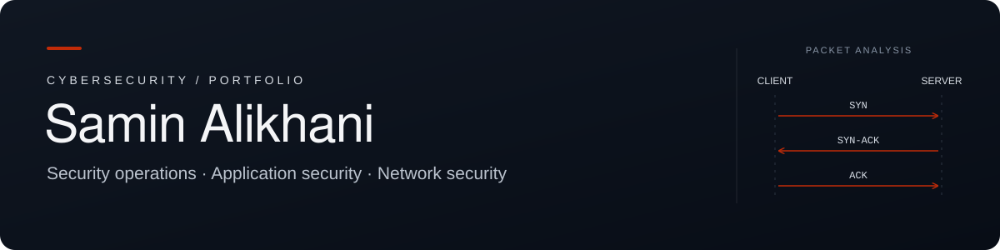

  

  <strong>M.S. Cybersecurity · UTSA · Expected December 2027</strong> 
  CompTIA Security+ · Former SOC Intern · San Antonio, Texas

  <a href="https://linkedin.com/in/saminalikhani">LinkedIn</a>
  &nbsp; / &nbsp;
  <a href="mailto:samin.alikhani.cs@gmail.com">Email</a>
  &nbsp; / &nbsp;
  <a href="#selected-projects">Projects</a>

---

I'm a Computer Science graduate pursuing an M.S. in Cybersecurity at the University of Texas at San Antonio. During my SOC internship, I investigated alerts using Microsoft Defender and Splunk and documented findings for senior analyst review.

My projects explore how security issues arise, how to investigate them, and how to test a fix. I also bring experience in Python data analysis, educational AI development, and customer service.

## Selected projects

### 01 / Application security
**[Stored XSS Remediation & Validation](https://github.com/Samin-Alikhani/Stored-XSS-Remediation-and-Validation)**

Reproduced stored XSS in a local PHP guestbook and addressed the vulnerable path with URL validation, output encoding, and safe JavaScript DOM construction. The repository includes HTTP and browser regression tests, a threat model, and before-and-after evidence.

`PHP` `JavaScript` `Python` `Playwright` `Secure coding`

### 02 / Security operations
**[Windows Authentication Monitoring with Splunk](https://github.com/Samin-Alikhani/Splunk-Windows-Authentication-Monitoring)**

Configured a Windows lab to forward authentication events to Splunk Cloud. Developed and tested a failed-logon detection, scheduled alert, and dashboard, with documented troubleshooting and detection limits.

`Splunk Cloud` `SPL` `Windows Event Logs` `Detection testing`

### 03 / Cybersecurity risk
**[Risk Assessment & Control Mapping](https://github.com/Samin-Alikhani/Cybersecurity-Risk-Assessment-and-Control-Mapping)**

Contributed CIS Controls and NIST framework mapping to a questionnaire-based academic team assessment. The anonymized case study includes risk and evidence registers, proposed remediation, and a separate synthetic-data recovery lab.

`CIS Controls v8` `NIST CSF` `Framework mapping` `Risk documentation`

## Tools & technical foundation

| Area | Tools and applied skills |
| --- | --- |
| Security operations | Microsoft Defender, Splunk, SPL, ServiceNow, alert investigation |
| Networking & systems | Wireshark, Nmap, TCP/IP, Windows, Linux, VMware |
| Development & data | Python, JavaScript, HTML/CSS, pandas, NumPy, Git/GitHub |
| Application security | Stored XSS analysis, input validation, output encoding, safe DOM construction |

## More lab work

- **[Wireshark Network Traffic Analysis](https://github.com/Samin-Alikhani/Wireshark-Network-Traffic-Analysis)** — controlled DNS, ICMP, TCP, and TLS analysis.
- **[Kali Linux Fundamentals](https://github.com/Samin-Alikhani/Kali-Linux-Fundamentals)** — system inspection, permissions, networking, and service discovery.
- **[Social Engineering Lab](https://github.com/Samin-Alikhani/Social-Engineering-Lab-Case-Study)** — authorized phishing simulation and supporting system troubleshooting.

## Currently learning

Preparing for the **CCNA**, with a focus on networking fundamentals and a longer-term interest in network security.

## Let's connect

I'm interested in **cybersecurity internships and entry-level opportunities** in security operations, application security, and network security.

[LinkedIn](https://linkedin.com/in/saminalikhani) · [Email](mailto:samin.alikhani.cs@gmail.com)
