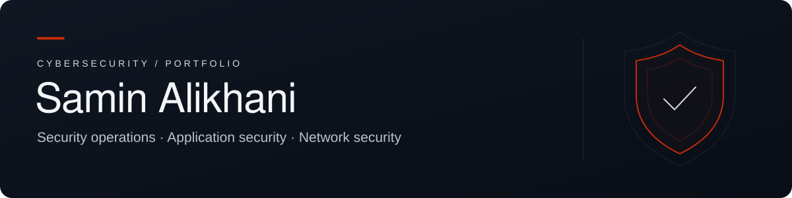

  

  <strong>M.S. Cybersecurity · UTSA · Expected December 2027</strong> 
  CompTIA Security+ · Former SOC Intern · San Antonio, Texas

  <a href="https://linkedin.com/in/saminalikhani">LinkedIn</a>
  &nbsp; | &nbsp;
  <a href="mailto:samin.alikhani.cs@gmail.com">Email</a>
  &nbsp; | &nbsp;
  <a href="#selected-projects">Projects</a>

---

I'm a Computer Science graduate pursuing an M.S. in Cybersecurity at the University of Texas at San Antonio. During my SOC internship, I investigated alerts using Microsoft Defender and Splunk and documented findings for senior analyst review.

My projects explore how security issues arise, how to investigate them, and how to test a fix. I also bring experience in Python data analysis, educational AI development, and customer service.

## Selected projects

<table>
  <tr>
    <td width="50%" align="left" valign="middle">
      
 01 / APPLICATION SECURITY

      <h3 align="left"></h3>
      
Reproduced stored XSS in a PHP guestbook and remediated the rendering path with URL validation, output encoding, and safe DOM construction. Includes HTTP and browser regression tests.

      
<code>PHP</code> <code>JavaScript</code> <code>Python</code> <code>Playwright</code> <code>Secure coding</code>

      
 

    </td>
    <td width="50%" align="left" valign="middle">
      
 02 / SECURITY OPERATIONS

      <h3 align="left"></h3>
      
Forwarded Windows authentication events to Splunk Cloud. Developed and tested a failed-logon detection, scheduled alert, and dashboard, with documented troubleshooting.

      
<code>Splunk Cloud</code> <code>SPL</code> <code>Windows Event Logs</code> <code>Detection testing</code>

      
 

    </td>
  </tr>
  <tr>
    <td width="50%" align="left" valign="middle">
      
 03 / CYBERSECURITY RISK

      <h3 align="left"></h3>
      
Contributed CIS and NIST framework mapping to an academic team assessment. The anonymized case study includes risk and evidence registers, proposed remediation, and an independent recovery lab.

      
<code>CIS Controls v8</code> <code>NIST CSF</code> <code>Framework mapping</code> <code>Risk documentation</code>

      
 

    </td>
    <td width="50%" align="left" valign="middle">
      
 04 / NETWORK SECURITY

      <h3 align="left"></h3>
      
Captured controlled DNS, ICMP, TCP, and TLS traffic. Correlated requests and responses, isolated an HTTPS conversation, and examined its TCP handshake and TLS 1.3 negotiation.

      
<code>Wireshark</code> <code>TCP/IP</code> <code>DNS</code> <code>TLS</code> <code>Packet analysis</code>

      
 

    </td>
  </tr>
</table>

## Tools & technical foundation

<table width="100%">
  <thead>
    <tr>
      <th width="25%" align="left"></th>
      <th width="75%" align="left"></th>
    </tr>
  </thead>
  <tbody>
    <tr>
      <td valign="middle"><strong>Security operations</strong></td>
      <td>
Microsoft Defender, Splunk, SPL, ServiceNow, alert investigation
</td>
    </tr>
    <tr>
      <td valign="middle"><strong>Networking &amp; systems</strong></td>
      <td>
Wireshark, Nmap, TCP/IP, Windows, Linux, VMware
</td>
    </tr>
    <tr>
      <td valign="middle"><strong>Development &amp; data</strong></td>
      <td>
Python, JavaScript, HTML/CSS, pandas, NumPy, Git/GitHub
</td>
    </tr>
    <tr>
      <td valign="middle"><strong>Application security</strong></td>
      <td>
Stored XSS analysis, input validation, output encoding, safe DOM construction
</td>
    </tr>
  </tbody>
</table>

## More lab work

- **[Kali Linux Fundamentals](https://github.com/Samin-Alikhani/Kali-Linux-Fundamentals)** — system inspection, permissions, networking, and service discovery.
- **[Social Engineering Lab](https://github.com/Samin-Alikhani/Social-Engineering-Lab-Case-Study)** — authorized phishing simulation and supporting system troubleshooting.

## Currently learning

Preparing for the **CCNA**, with a focus on networking fundamentals and a longer-term interest in network security.

## Let's connect

I'm interested in **cybersecurity internships and entry-level opportunities** in security operations, application security, and network security.

[LinkedIn](https://linkedin.com/in/saminalikhani) · [Email](mailto:samin.alikhani.cs@gmail.com)
